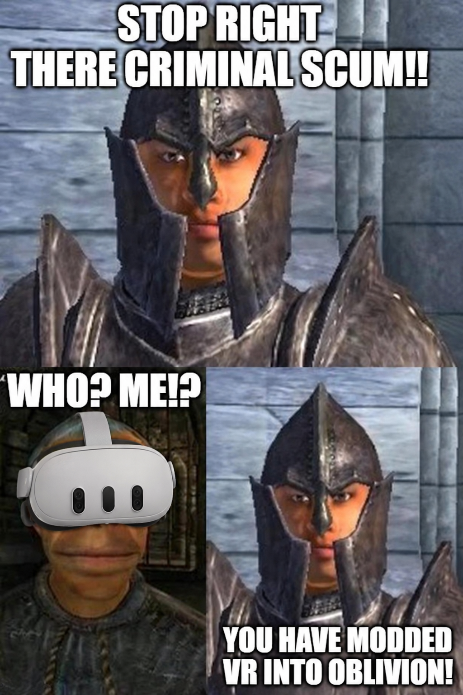

# OBVR - TES4 Oblivion (2006) in VR



Play the original **The Elder Scrolls IV: Oblivion** in real VR. Real 3D, head
tracking, your menus and HUD in the headset. (Not for the Remastered edition.)

**Get the latest download:** [Releases](https://github.com/Naragorn/OBVR/releases) -
the newest one is at the top. **Status: early test build (0.2.x).** Sit down, grab
your mouse, keyboard or gamepad and you're in Cyrodiil - that part works and is
what the download here is for.

**Full VR beta on Discord.** Standing with motion controllers (swords in your
hand, blocking, grabbing, teleport) is in a closed beta. The beta build is handed
out in our Discord channel only, not here yet - join if you want to test it, Index
or other controllers: https://discord.com/channels/747967102895390741/1547539304786436228
The download here stays the seated version.

**Join the Discord** (same link) for questions, bug reports, screenshots, or just
to say hi.

**Want to support OBVR?** Tips go to https://ko-fi.com/somadb (that Ko-fi is mine,
see [Supporting the work](#supporting-the-work) for Patreon and crypto too).

## What you get

- **Real 3D.** Each eye gets its own picture, so the world has depth.
- **Head tracking.** Look around and lean in, the camera follows your head.
  You still walk with mouse/keyboard or gamepad. Prefer to steer the view with
  the mouse or the stick instead, the picture fixed in front of you? Switch
  `[Head] HeadLook` off (the "Headset steers the view" row in the settings).
- **Aim with your head.** Bows, spells and swords go where you look, in first and
  third person. Walking stays independent of where you look.
- **One clean crosshair** that sits at the distance of what you're aiming at.
- **HUD, menus and dialogue in the headset.** Pause menus float in front of the
  world with Oblivion's own sepia look. Main menu, loading screens and videos
  play on a big cinema screen.
- **A welcome walkthrough and a settings menu** inside the headset (`Insert`).
- **Recenter** your view with the `Delete` key (`Entf` on German keyboards).
- **Comfort options** like smooth turning.
- Works with or without the 4GB patch, and with Mod Organizer 2.

## Full VR: standing with motion controllers (beta on Discord)

The big one. Swords in your hand, swings that hit where the blade touches, block
with your shield or your blade, grab and throw things, hold a two-hander with both
hands, shove people, lead NPCs by the hand, your HUD on your wrist, and more. It is
built and playable, tested on one setup so far, with rough edges. The beta build is
handed out in the **Discord channel** linked above; it is not in the download here
or on Nexus yet. In the beta build the first start asks which way you want to play,
then a short guide walks you through recentering, your weapon hand, the controls and
the comfort settings. In the public download Full VR stays off (`[Hands] Enabled` in
`OBVR.ini`).

### Controls in Full VR

Right-handed layout; `[Hands] LeftHanded=1` swaps the hands, and the arms are
drawn mirrored with it, so a left hand holds the weapon. Index and Quest
controllers have their own bindings, other controllers are untested. The same
card is in the game: settings menu, Help, "Show the controls".

| | Weapon hand (right) | Other hand (left) |
| --- | --- | --- |
| Trigger | bow: draw while held, loose on release | cast the spell |
| Grip | at a hip: draw or put away a one-hander; behind a shoulder: a two-hander or staff; on an item: hold it - let go at your chest to keep it, mid-swing to throw it | grab or hold an item; at a hip or behind a shoulder: the bow (shoulders), a shield (anywhere) or a torch (hips) |
| Swing | a drawn weapon hits where the blade touches; a long, fast swing is a power attack | a fist punches |
| Raise the hand | - | shield on the arm: block. Both hands up and open, palms to the foe, rocked gently left and right for a second: yield |
| A | open a door, talk to someone, use what the laser points at. Loose items are not picked up with A: hold them by the grip and bring them to your chest (the gold ring) | in the inventory: drop the item under the cursor |
| B | pause menu (Escape) | the Tab menus; they hang on this wrist, the other hand's laser clicks |
| Stick | turn; held up: aim a teleport, let go to go; flick up: jump; flick down: sneak | walk; pressed in: run |
| Stick button | short click: the hotkey ring - move the hand to a slot, click again (in the middle: close). On an Index the trackpad does it. Held: the rest menu | short click: the spell ring - the spells you know, click again on one to make it your spell. On an Index the trackpad does it. Held: run |
| Trackpad (Index) | held: the hotkey ring, let go on a slot | held: the spell ring, let go on a spell |
| Both stick buttons | clicked together: OBVR's settings. Held three seconds: recenter | |

**Holsters, like Blade & Sorcery:** four places on your body - both hips and
behind both shoulders - each keep one thing. One-handers and torches go at a
hip, two-handers, staffs and bows behind a shoulder, a shield anywhere. Let go
of a weapon at a free place to put it there; grip an empty hand there to take
it back. **Weapons (and arrows) are the weapon hand's job; the bow, the shield
and the torch the other hand's** - that is how Oblivion holds them. Reach with
the wrong hand and a little sign at the place tells you. Arrows come from over
your shoulder or from either hip.

Make a fist (or squeeze the grip hard) to raise your fists; crouch to sneak.
In a new game, the prison tutorial's cards name these controls instead of the keys.

## Known issues

- The recenter key does nothing during the intro videos. It works from the main
  menu on.
- Typing text (like your character's name) still needs the keyboard.
- Oblivion Reloaded, ORC, E3 and Enhanced Camera don't work together with OBVR.
  Trifle needs its first-person shadow off. See [Compatibility](#compatibility).

## What you need

- Oblivion **1.2.0.416** (32-bit). **Steam version tested**; GOG and disc with the
  last patch should work but are untested.
- [xOBSE](https://github.com/llde/xOBSE/releases/latest) 22.13 or newer.
- [MenuQue v16b](https://www.nexusmods.com/oblivion/mods/32200), for the
  in-headset menus. Without it you get simpler fallback menus, VR still works.
- [DXVK, the gplasync build](https://gitlab.com/Ph42oN/dxvk-gplasync/-/releases). Not
  optional. That build keeps drawing while new shaders compile, so fewer hitches in
  the headset. Take the newest entry on that page, the zip.
- **SteamVR** and a headset it runs. Meta headsets (Quest via Link, Air Link,
  Virtual Desktop or Steam Link, Rift) work like any other SteamVR game.
- Windows 10 or 11, or Linux with Steam's Proton - see [On Linux](#on-linux-steam-proton).

Tested so far: Dream Air headset, Valve Index controllers, RTX 4090, Windows 11 -
and on Linux a Bigscreen Beyond with the same controllers and card, CachyOS and
Proton-CachyOS. Everything else is exactly what your reports are for.

## Installing

1. **xOBSE:** put `obse_1_2_416.dll`, `obse_editor_1_2.dll`,
   `obse_steam_loader.dll`, `obse_loader.exe` and its `Data` folder into your
   Oblivion folder.
2. **DXVK:** from the `x32` folder of the gplasync archive, copy only `d3d9.dll` next to
   `Oblivion.exe`. Then make a text file called `dxvk.conf` in the same folder
   with these two lines in it:

   ```
   dxvk.enableMemoryDefrag = False
   d3d9.cachedWriteOnlyBuffers = True
   ```

   <!--- The second line keeps the game's vertex buffers in system memory. Without it
   the engine's copy into them can run at PCIe speed and cost a millisecond a
   frame with people in view (measured 2026-10-23, docs/performance-spec.md). --->
3. **OBVR:** download `OBVR-<version>.zip` from
   **[Releases](https://github.com/Naragorn/OBVR/releases)** and extract it into
   Oblivion's `Data` folder.
4. **MenuQue v16b:** merge its `Data` folder into Oblivion's (or install it as its
   own mod in MO2).
5. **Only for 0.2.1 and older:** copy the **32-bit** `openvr_api.dll` from
   `Steam\steamapps\common\SteamVR\bin\win32\` into `Data/OBSE/Plugins/`, next to
   `OBVR.dll`. Newer versions bring it along.
6. **Turn off the Steam Overlay for Oblivion.** In your Steam Library, right-click
   **Oblivion > Properties > General** and switch the overlay off. This is required.
7. Start SteamVR, then start the game with **`obse_loader.exe`** in your Oblivion
   folder - not with Steam's Play button.

**Tip - start it from the VR library:** in Steam, **Games > Add a Non-Steam Game to
My Library...**, pick `obse_loader.exe` from your Oblivion folder. Now it shows up in
your library and you can start it right from SteamVR's game list, headset on.

### On Linux (Steam Proton)

OBVR runs under Proton too. Tested with Proton-CachyOS, other Proton builds not
yet. Same mod, just a few steps differ:

1. **xOBSE:** same files as above into the Oblivion folder. Then let Steam's Play
   button start it: rename `OblivionLauncher.exe` to `OblivionLauncher.exe.vanilla`
   and put a copy of `obse_loader.exe` there as `OblivionLauncher.exe`.
   Proton-CachyOS does this swap on its own when it finds `obse_loader.exe`.
2. **DXVK:** skip the `d3d9.dll`, Proton brings its own DXVK. The `dxvk.conf`
   with its two lines still goes next to `Oblivion.exe` - Proton's DXVK reads it.
3. **OBVR and MenuQue:** exactly as above.
4. Start SteamVR, then hit **Play** in Steam.

The Linux stutter is fixed: OBVR no longer waits for your monitor while you play in VR. If you want vsync on the monitor back, set `MonitorVsync=1` in `[Render]`.

**Mod Organizer 2:** just install the OBVR zip as a normal mod. OBVR itself doesn't
need Root Builder (xOBSE's own files in the game folder do).

**Uninstalling:** delete `dxvk.conf` from your Oblivion folder (and `d3d9.dll`
too, if you don't use DXVK for anything else), then `OBVR.dll`, `OBVR.ini`, `OBVR-LICENSE.txt`,
`OBVR-crosshair.cache`, `openvr_api.dll`, `openvr_api-LICENSE.txt` and the
`OBVR_Input` folder from `Data/OBSE/Plugins/`, plus `OBVR_Onboarding.xml`,
`OBVR_Settings.xml`, `OBVR_Update.xml`, `OBVR_AdjustHands.xml` and
`OBVR_Controls.xml` from `Data/Menus/Generic/`, the `Data/Menus/Prefabs/OBVR/`
folder and the `Data/Textures/Menus/OBVR/` folder (the controls card's drawings).
OBVR doesn't touch your saves. Want to rule OBVR out quickly? Set
`[Camera] HookEnabled=0` in `OBVR.ini`.

## Settings

Press `Insert` in the game for the settings menu. Everything else lives in
`OBVR.ini` (in `Data/OBSE/Plugins/`), each option explained right above it. Changes
apply while the game runs, no restart needed.

A few worth knowing:

| Setting | What it does |
| --- | --- |
| `[Render] Stereo` | `dual` real 3D (default), `aer` lighter fallback, `none` flat |
| `[Render] EyeSeparationScale` | depth boost: above `1.0` the world feels deeper and a bit smaller. Stay below ~1.5 |
| `[Render] Menus` | `world` menus float in front of you, `cinema` on a flat screen |
| `[Head] RecenterKey` | the recenter key, `Delete` (`Entf`) by default |
| `[Head] HeadLook` | `1` the head steers the view; `0` the mouse or the stick do, the picture stays in front of your face |
| `[Look] *` | turning, aiming and comfort options |
| `[Hands] Enabled` | Full VR, standing with motion controllers - the beta build asks on the first start; off in the public download |
| `[Hands] LeftHanded` | left-handed: the controllers swap roles and the arms are drawn mirrored - a left hand holds the weapon, the body's arms reach across |

## Found a bug?

Tell us on [Discord](https://discord.com/channels/747967102895390741/1547539304786436228)
or open an issue on the **Issues** tab here. Please include:

- **`OBVR.log` and `OBVR.log.prev`** from your Oblivion folder. Without them we
  can rarely fix anything. (They contain your install path, nothing else personal.)
- **For crashes: the crash log.** Please install
  [Crash Logger Improved](https://www.nexusmods.com/oblivion/mods/54527) - when the
  game crashes, it writes down what the game was doing, and that often points
  straight at the culprit. Send its log along.
- What you did and what you saw.
- Your headset, graphics card, and other mods you use - other mods are the most
  common cause of trouble.
- If the game froze instead of crashing: did the monitor still move? Did SteamVR
  still track?

## Compatibility

- **Oblivion Reloaded, Oblivion Reloaded Combined, E3:** don't work with OBVR. They
  change the same parts of the game OBVR needs. Pick one.
- **Enhanced Camera:** doesn't work with OBVR. The game runs flat while it's
  installed; remove `OBSE_EnhancedCamera.dll` to play in VR.
- **Trifle:** works, but switch off its first-person shadow. With
  `EnableFirstPersonShadow=1` in `Data\OBSE\Plugins\Trifle.ini` it hides your
  body every frame, so in Full VR you only see your hands. Set it to `0`.
- **NorthernUI:** works (tested with 2.0.3).
- **ENB:** not tested.
- Other mods that don't change graphics or the camera should be fine. Tell us either
  way!

### Other mods I'd recommend

- **My other little plugins:**
  [Sep2026LoadingCrashFix](https://github.com/Naragorn/Sep2026LoadingCrashFix) - the
  game crashes before the loading screen since the Windows 11 update KB5124010? This
  fixes it. [FoliageAA](https://github.com/Naragorn/FoliageAA) - no more shimmering
  tree leaves in the distance, which you notice a lot in the headset. Still fresh,
  tell me how it looks for you.
- **For a stable base:** follow
  [Oblivion For Modern PCs](https://www.nexusmods.com/oblivion/mods/54158), but skip
  the graphics parts - ORC (Oblivion Reloaded Combined), ENBoost, DXVK and the like.
  OBVR brings its own setup for those.
- **Overhauls:** [Maskar's Oblivion Overhaul (MOO)](https://www.nexusmods.com/oblivion/mods/42780)
  and [Ascension](https://www.nexusmods.com/oblivion/mods/50237) - both together, they
  play nicely.
- **Also nice:** [My Voice Extender](https://www.nexusmods.com/oblivion/mods/29067).
- **For Full VR:** [Put it in its Place](https://www.nexusmods.com/oblivion/mods/19847)
  together with its [AI Voices Addon](https://www.nexusmods.com/oblivion/mods/52893).
  OBVR hands your slaps over to it, so a slap in the face gets the mod's full reaction,
  and grabbing someone's stuff no longer counts as theft. The addon gives the mod's
  lines a voice.
- **Also for Full VR:** [Ragdolls for Oblivion](https://www.nexusmods.com/oblivion/mods/51844)
  (the main file is enough). Reworked ragdolls for every skeleton - bodies are lighter
  when you grab and hold them. I'm testing it with OBVR right now. It replaces the
  skeletons, so it clashes with other mods that do the same.

## For modders and developers

The deep dive lives in the repo:

- `HANDOFF.md` - how OBVR works inside, and every dead end on the way.
- `docs/` - the specs for every feature, including the standing mode.
- `docs/vr-modding/` - a knowledge base for bringing flat games into VR.

**Building:** Oblivion is 32-bit, so build 32-bit, with Visual Studio 2022 Build Tools:

```
cmake -B build -G Ninja -DCMAKE_BUILD_TYPE=Release .
cmake --build build
```

**Tests** are their own project; build them 32-bit too:

```
cmake -B build-tests tests -G Ninja -DCMAKE_BUILD_TYPE=Release
cmake --build build-tests
ctest --test-dir build-tests --output-on-failure
```

On Linux the tests build with clang in 32-bit mode; `docs/linux.md` has the
command and what else the Linux side can and cannot do yet.

`tools/package-release.ps1` builds the release zip on Windows, `tools/package-release.py`
on Linux. Pull requests are welcome;
two house rules: every game address needs two independent sources, and fixes go
after the cause, not the symptom. Everything in the repo is in English.

## Supporting the work

OBVR is free and stays free. If it gets you into Cyrodiil and you want to buy a
coffee for the evenings it took:

- **Ko-fi:** https://ko-fi.com/somadb (somadb is a different project I work on,
  but I confirm this Ko-fi link goes to me, the one who made OBVR.)
- **Patreon:** https://www.patreon.com/naragorn

Patrons get new builds of this and future VR mods early, with testing notes, and on
higher tiers a vote on which game gets the VR treatment next. Every build still
lands here - early access is a head start, not a lock.

Crypto tips are welcome too:

| Coin | Address |
| --- | --- |
| BTC | `bc1q78akvct56ctrgcz0ahzthm3sjayu96tl8fdhc4` |
| ETH (Ethereum network) | `0x94c3Ec9707a1ac383F40Bb55Bff63d37175AC666` |
| SOL | `5GYdnxLnKByKuptpHtqkcmCx8LTjaMm5BtkoFN4jvCEU` |

## License

**GNU General Public License v3** (`LICENSE`). Copyright (C) 2026 Naragorn.

In short: use it, change it, share it, build on it. If you pass it on, pass the
source on with it under the same license. No closed or paid-for versions. The
license text is what counts; this is just the summary.

`src/obse/PluginInterface.h` copies the layout of two structs from xOBSE's
`PluginAPI.h` so the plugin can load, like every OBSE plugin does.

## Thanks to

- [xOBSE](https://github.com/llde/xOBSE) - the plugin loader.
- [OpenVR](https://github.com/ValveSoftware/openvr) - the VR runtime.
- [DXVK](https://github.com/doitsujin/dxvk) - Direct3D 9 on Vulkan.
- [dxvk-gplasync](https://gitlab.com/Ph42oN/dxvk-gplasync) - DXVK with async shader compilation, the build OBVR is tested with.
- [NorthernUI](https://github.com/DavidJCobb/NorthernUI) and
  [TESReloaded](https://github.com/llde/TESReloaded) - reverse-engineering references.
- [openRBRVR](https://github.com/Detegr/openRBRVR) - the closest relative, another
  32-bit game brought into VR.
