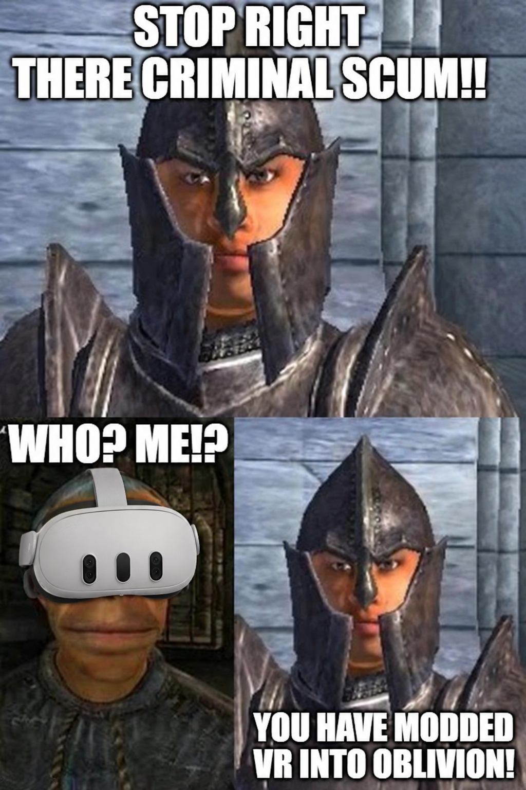

# OBVR - TES4 Oblivion (2006) in VR



Play the original **The Elder Scrolls IV: Oblivion** in VR. Real 3D, head
tracking, and your menus in the headset. (Not for the Remastered edition.)

- **Download:** [Releases](https://github.com/Naragorn/OBVR/releases). The newest one is at the top.
- **Status:** early test build (0.2.x).
- **How you play it:** sitting down, with mouse and keyboard or a gamepad.

**Want to play standing, with motion controllers?** That is "Full VR". It is in a
closed beta, and you only get it on our Discord:

1. Join the Discord: https://discord.gg/dc7QVES3Mj
2. Open the OBVR thread. The beta is there: https://discord.com/channels/747967102895390741/1547539304786436228

The Discord is also the place for questions, bug reports and screenshots.

**Want to support OBVR?** See [Supporting the work](#supporting-the-work).

## What you get

- **Real 3D.** Each eye gets its own picture.
- **Head tracking.** Look around and lean in. You still walk with mouse,
  keyboard or gamepad.
- **Aim with your head.** Bows, spells and swords go where you look.
- **A crosshair** that sits on what you aim at.
- **Menus, HUD and talking in the headset.** The main menu, loading screens and
  videos play on a big cinema screen.
- **A short guide and a settings menu** in the headset. Press `Insert`.
- **Recenter** with the `Delete` key (`Entf` on German keyboards).
- **Comfort options**, like smooth turning.
- Works with or without the 4GB patch, and with Mod Organizer 2.

Don't want the view to follow your head? Turn off `[Head] HeadLook`. Then the
mouse or the stick turns the view.

## Full VR (beta, only on Discord)

Stand up and use your hands:

- Hold your sword. It hits where the blade touches.
- Block with your shield or your blade.
- Grab things and throw them.
- Hold a big sword with both hands.
- Kick and shove people. Lead people by the hand.
- A fast killing blow can cut off a head, a hand, an arm or a leg.

It works, but it has rough edges. It was only tested on one PC so far.

The first start asks how you want to play. Then a short guide shows you the
controls. In the normal download Full VR is off.

### Controls in Full VR

This is for right-handed players. Left-handed? Set `[Hands] LeftHanded=1`.
Index and Quest controllers work. Other controllers are not tested.
You find the same list in the game: settings menu, Help, "Show the controls".

| | Right hand (weapon) | Left hand |
| --- | --- | --- |
| Trigger | bow: hold to draw, let go to shoot | cast your spell |
| Grip | at your hip or behind your shoulder: take out or put away a weapon. On an item: hold it | grab an item. At your hip or shoulder: take the bow, shield or torch |
| Swing | hit with your weapon. A long, fast swing is a power attack | punch |
| Raise your hand | - | with a shield: block |
| A | open doors, talk, use things | in the inventory: drop the item |
| B | kick (in a menu: back) | tap: open the menus on your wrist. Hold 2 seconds: pause menu |
| Stick | turn. Push up: teleport. Flick up: jump. Flick down: sneak | walk. Press in: run |
| Stick button | click: hotkey ring. Hold: wait/rest | click: spell ring. Hold: run |
| Trackpad (Index) | hold: hotkey ring | hold: spell ring |
| Both stick buttons | click: OBVR settings. Hold 3 seconds: recenter | |

More tips:

- **Picking up items:** hold the item with the grip and bring it to your chest.
- **Give up a fight (yield):** raise both open hands, palms to the enemy, and
  move them gently left and right for a second.
- **Holsters:** you have four places on your body, both hips and behind both
  shoulders. Let go of a weapon there to put it away. Grip there to take it back.
  Swords and torches go at the hips, big weapons and bows on the back.
  Potions work the same way: take one and bring it to your mouth to drink.
- **Picking a lock:** point at a pin, push the stick up to push it, and pull the
  trigger when it is at the top.
- **Your own buttons:** change them in `OBVR_Controls.ini`, next to `OBVR.ini`.
  The file explains every button.

## Known issues

- The recenter key doesn't work during the intro videos. It works from the main
  menu on.
- Some mods don't work with OBVR. See [Compatibility](#compatibility).

## What you need

- Oblivion **1.2.0.416**. The **Steam version** is tested. GOG and disc should
  work, but are not tested.
- [xOBSE](https://github.com/llde/xOBSE/releases/latest) 22.13 or newer.
- [MenuQue v16b](https://www.nexusmods.com/oblivion/mods/32200) for the menus
  in the headset. VR also works without it, with simpler menus.
- [DXVK gplasync](https://gitlab.com/Ph42oN/dxvk-gplasync/-/releases). You need
  this. It makes the game stutter less. Take the newest zip on that page.
- **SteamVR** and a headset that works with it. Quest headsets work too (Link,
  Air Link, Virtual Desktop or Steam Link).
- Windows 10 or 11, or Linux with Proton. See [On Linux](#on-linux-steam-proton).

Tested on: Dream Air and Bigscreen Beyond headsets, Index controllers, RTX 4090,
Windows 11 and CachyOS Linux. Tell us how it works on your setup!

## Installing

1. **xOBSE:** copy `obse_1_2_416.dll`, `obse_editor_1_2.dll`,
   `obse_steam_loader.dll`, `obse_loader.exe` and its `Data` folder into your
   Oblivion folder.
2. **DXVK:** open the gplasync zip. From its `x32` folder, copy only `d3d9.dll`
   next to `Oblivion.exe`. Then make a text file named `dxvk.conf` in the same
   folder, with these two lines:

   ```
   dxvk.enableMemoryDefrag = False
   d3d9.cachedWriteOnlyBuffers = True
   ```

   <!--- The second line keeps the game's vertex buffers in system memory. Without it
   the engine's copy into them can run at PCIe speed and cost a millisecond a
   frame with people in view (measured 2026-10-23, docs/performance-spec.md). --->
3. **OBVR:** download `OBVR-<version>.zip` from
   [Releases](https://github.com/Naragorn/OBVR/releases). Unpack it into
   Oblivion's `Data` folder.
4. **MenuQue:** copy its `Data` folder into Oblivion's folder (or install it as a
   mod in MO2).
5. **Only for OBVR 0.2.1 and older:** copy the **32-bit** `openvr_api.dll` from
   `Steam\steamapps\common\SteamVR\bin\win32\` into `Data/OBSE/Plugins/`.
   Newer versions already have it.
6. **Turn off the Steam Overlay for Oblivion.** You must do this. In Steam,
   right-click **Oblivion > Properties > General** and turn the overlay off.
7. Start SteamVR. Then start the game with **`obse_loader.exe`** in your
   Oblivion folder, not with Steam's Play button.

**Tip:** in Steam, click **Games > Add a Non-Steam Game to My Library...** and
pick `obse_loader.exe`. Now you can start the game from SteamVR with your
headset on.

**Mod Organizer 2:** install the OBVR zip like any other mod.

### On Linux (Steam Proton)

Tested with Proton-CachyOS. Most steps are the same. These are different:

1. **xOBSE:** copy the same files. Then rename `OblivionLauncher.exe` to
   `OblivionLauncher.exe.vanilla`, and put a copy of `obse_loader.exe` there as
   `OblivionLauncher.exe`. (Proton-CachyOS does this for you.)
2. **DXVK:** don't copy `d3d9.dll`. Proton has its own. You still need the
   `dxvk.conf` file next to `Oblivion.exe`.
3. **OBVR and MenuQue:** same as above.
4. Start SteamVR, then press **Play** in Steam.

### Uninstalling

Delete these files:

- From the Oblivion folder: `dxvk.conf` (and `d3d9.dll`, if nothing else needs it).
- From `Data/OBSE/Plugins/`: `OBVR.dll`, `OBVR.ini`, `OBVR_Controls.ini`,
  `OBVR-LICENSE.txt`, `OBVR-crosshair.cache`, `openvr_api.dll`,
  `openvr_api-LICENSE.txt` and the `OBVR_Input` folder.
- From `Data/Menus/Generic/`: `OBVR_Onboarding.xml`, `OBVR_Settings.xml`,
  `OBVR_Update.xml`, `OBVR_AdjustHands.xml` and `OBVR_Controls.xml`.
- The folders `Data/Menus/Prefabs/OBVR/` and `Data/Textures/Menus/OBVR/`.

OBVR doesn't change your saves. To turn OBVR off quickly without deleting it, set
`[Camera] HookEnabled=0` in `OBVR.ini`.

## Settings

Press `Insert` in the game for the settings menu. All settings are also in
`OBVR.ini` (in `Data/OBSE/Plugins/`). Each one is explained in the file.
Changes work right away, you don't need to restart.

Some useful ones:

| Setting | What it does |
| --- | --- |
| `[Render] Stereo` | `dual` real 3D (default), `aer` lighter, `none` flat |
| `[Render] EyeSeparationScale` | more depth when above `1.0`. Stay below 1.5 |
| `[Render] Menus` | `world` menus float in front of you, `cinema` on a flat screen |
| `[Render] GrassDistance`, `GrassDensity` | how far grass reaches and how much grass there is. `0` keeps the game's own |
| `[Render] MonitorVsync` | `1` turns vsync on the monitor back on (Linux) |
| `[Head] RecenterKey` | the recenter key. Default: `Delete` (`Entf`) |
| `[Head] HeadLook` | `1` your head turns the view. `0` the mouse or stick does |
| `[Head] RealHeight` | `1` you see the world from your real height. Turn it off when you sit |
| `[Look] *` | turning and comfort options |
| `[Hands] Enabled` | Full VR on or off |
| `[Hands] LeftHanded` | `1` for left-handed players |
| `[Hands] Dismemberment` | `1` strong killing blows can cut off body parts. `0` off |
| `[Hands] ContactHaptics` | `1` the controller buzzes when your blade or hand touches something. Off by default |
| `[Hands] HitHaptics` | `1` the controller buzzes when you hit something. On by default |
| `[Hands] BladeSticks` | `1` a stab can get stuck in a body until you pull the blade out |
| `[Hands] NeckBleeds` | `1` a cut in the neck keeps bleeding for a while |
| `[Hands] Kick` | `1` the right B button kicks. `0` it opens the pause menu |

## Found a bug?

Tell us on Discord ([join](https://discord.gg/dc7QVES3Mj) first, then post in the
[OBVR thread](https://discord.com/channels/747967102895390741/1547539304786436228)),
or open an issue here on GitHub. Please send:

- **`OBVR.log` and `OBVR.log.prev`** from your Oblivion folder. We need them to fix
  things. They only show your install folder, nothing else personal. Older logs
  are in the `OBVR-logs` folder.
- **If the game crashed:** install
  [Crash Logger Improved](https://www.nexusmods.com/oblivion/mods/54527) and send
  its log.
- What you did and what happened.
- Your headset, graphics card and your other mods. Other mods are the most
  common cause of problems.
- If the game froze: did the monitor still move? Did SteamVR still track?

## Compatibility

- **Oblivion Reloaded, ORC and E3** don't work with OBVR. Pick one.
- **Enhanced Camera** doesn't work with OBVR. Remove `OBSE_EnhancedCamera.dll`
  to play in VR.
- **Trifle** works, but set `EnableFirstPersonShadow=0` in
  `Data\OBSE\Plugins\Trifle.ini`. Otherwise you only see your hands in Full VR.
- **NorthernUI** works (tested with 2.0.3).
- **Nehrim:** not tested yet.
- **ENB:** not tested.
- Most other mods should be fine. Tell us either way!

### Mods I recommend

- **My other plugins:**
  - [Sep2026LoadingCrashFix](https://github.com/Naragorn/Sep2026LoadingCrashFix):
    fixes the crash before the loading screen since Windows update KB5124010.
  - [FoliageAA](https://github.com/Naragorn/FoliageAA): stops tree leaves from
    shimmering in the distance.
  - [Oblivion Frame Fixes](https://github.com/Naragorn/OblivionFrameFixes):
    smoother frames and fewer hitches.
  - [Oblivion Walkers](https://github.com/Naragorn/OblivionWalkers): a zombie
    apocalypse that works with OBVR.
- **A stable game:** follow
  [Oblivion For Modern PCs](https://www.nexusmods.com/oblivion/mods/54158), but
  skip the graphics parts (ORC, ENBoost, DXVK and so on). OBVR has its own.
- **Overhauls:** [Maskar's Oblivion Overhaul (MOO)](https://www.nexusmods.com/oblivion/mods/42780)
  and [Ascension](https://www.nexusmods.com/oblivion/mods/50237). They work well
  together.
- **Also nice:** [My Voice Extender](https://www.nexusmods.com/oblivion/mods/29067).
- **For Full VR:**
  - [Put it in its Place](https://www.nexusmods.com/oblivion/mods/19847) with its
    [AI Voices Addon](https://www.nexusmods.com/oblivion/mods/52893). People react
    when you slap them, and grabbing their things is not stealing.
  - [Ragdolls for Oblivion](https://www.nexusmods.com/oblivion/mods/51844) (the
    main file is enough). Bodies are lighter to grab and hold. It replaces the
    skeletons, so it doesn't work with other skeleton mods.

## For modders and developers

- `HANDOFF.md` explains how OBVR works inside.
- `docs/` has the plans for every feature.
- `docs/vr-modding/` is a knowledge base for bringing flat games into VR.

**Building:** Oblivion is 32-bit, so build 32-bit with Visual Studio 2022 Build Tools:

```
cmake -B build -G Ninja -DCMAKE_BUILD_TYPE=Release .
cmake --build build
```

**Tests** (also 32-bit):

```
cmake -B build-tests tests -G Ninja -DCMAKE_BUILD_TYPE=Release
cmake --build build-tests
ctest --test-dir build-tests --output-on-failure
```

On Linux the tests build with clang. See `docs/linux.md`.

The release zip is built with `tools/package-release.ps1` (Windows) or
`tools/package-release.py` (Linux).

Pull requests are welcome. Two rules: every game address needs two sources, and
fix the cause, not the symptom. Everything in the repo is in English.

## Supporting the work

OBVR is free and stays free. If you want to buy me a coffee:

- **Ko-fi:** https://ko-fi.com/somadb (the name is from another project of mine,
  but the money goes to me, the maker of OBVR).
- **Patreon:** https://www.patreon.com/naragorn

Patrons get new builds early and can vote on the next game to bring to VR.
Every build still comes out here later.

Crypto:

| Coin | Address |
| --- | --- |
| BTC | `bc1q78akvct56ctrgcz0ahzthm3sjayu96tl8fdhc4` |
| ETH (Ethereum network) | `0x94c3Ec9707a1ac383F40Bb55Bff63d37175AC666` |
| SOL | `5GYdnxLnKByKuptpHtqkcmCx8LTjaMm5BtkoFN4jvCEU` |

## License

**GNU General Public License v3** (`LICENSE`). Copyright (C) 2026 Naragorn.

In short: you can use, change and share it. If you share it, share the source
code too, under the same license. The license text is what counts.

`src/obse/PluginInterface.h` copies the layout of two structs from xOBSE's
`PluginAPI.h`, like every OBSE plugin does.

## Thanks to

- [xOBSE](https://github.com/llde/xOBSE) - the plugin loader.
- [OpenVR](https://github.com/ValveSoftware/openvr) - the VR runtime.
- [DXVK](https://github.com/doitsujin/dxvk) - Direct3D 9 on Vulkan.
- [dxvk-gplasync](https://gitlab.com/Ph42oN/dxvk-gplasync) - the DXVK build OBVR is tested with.
- [NorthernUI](https://github.com/DavidJCobb/NorthernUI) and
  [TESReloaded](https://github.com/llde/TESReloaded) - for reverse-engineering help.
- [openRBRVR](https://github.com/Detegr/openRBRVR) - another 32-bit game brought into VR.
