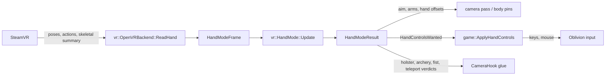

# Full VR hands and controller input

OBVR has two shapes: the head-tracked seated mod (the headset moves the camera, mouse/keyboard/gamepad do the rest) and the hand-tracked mode, called Full VR in the UI. The switch is `[Hands] Enabled` in `OBVR.ini`, read into `Config::fullVrMode` (default off in code) and mirrored into `hands.enabled` after a load. See [Configuration](../operations/configuration.md).

## Data flow per frame

1. **Reading.** `OpenVRBackend::ReadHand` finds each controller by role (`GetTrackedDeviceIndexForControllerRole`), takes its pose in the seated universe from `GetDeviceToAbsoluteTrackingPose`, and reads buttons and axes through the SteamVR action manifest `OBVR_Input/actions.json` (found next to the DLL first, then under `Data\OBSE\Plugins`). Once the manifest is active the legacy controller-state path is bypassed; a failed action read is logged once and leaves the controls neutral while the pose stays valid. Finger curl comes from the skeletal summary. Older text in `docs/hand-tracked-mode.md` still describes the legacy path; the source is authoritative.
2. **Deciding.** `UpdateHandMode` in `src/camera/CameraHook.cpp` builds a `HandModeFrame` (head pose, both hands, frame time, menu state, first person, weapon kind, shield, role swap for left-handers) and calls `g_handMode.Update`. It runs from `OnPresent`, so it also runs on menu frames where the camera pass does not.
3. **Acting.** The `HandModeResult` carries the aim (yaw turn and sine of pitch from the right hand), arm rotation/offset, per-hand offsets, velocities, finger curl, and verdicts from the sub-steps. `game::ApplyHandControls` presses and releases the game's controls to match `HandControlsWanted`.

## vr::HandMode

`vr::HandMode` (`src/vr/HandMode.h`, `.cpp`) is pure apart from a few frames of state (ready-weapon follow, tap holds, sneak/crouch, weapon lag). It:

- returns an empty result and resets when the head is invalid, or when the mode is off and controllers are not used for menus; with the mode off but `menusOnly` set it only steers menus (`UpdateMenusOnly`);
- computes hand offsets relative to the head in metres, in the game's axes (x right, y forward, z up), converted to game units by `unitsPerMetre`;
- derives the aim from the right hand's orientation relative to the head;
- places the arms by how far the controller is from a rest pose (`restHandRight/Forward/Up`), optionally following pitch and position, mirrored for left-handers;
- composes sub-steps that live in their own pure headers: `Holster.h`, `Archery.h`, `Fist.h`, `GripHold.h`, `Teleport.h`, `QuickMenu.h`, `Stow.h`, `ReachOpen.h`, `TwoHandLogic.h`, `OneHandTwoHander.h`, `WeaponWeight.h`, `WalkDirection.h`;
- routes both sticks to OBVR's own settings menu while it is open (both sticks clicked opens it, `StepChord`).

Settings for all of this are `vr::HandSettings`, hot-reloaded from `[Hands]`.

## Turning decisions into game input

`src/game/HandControls.h` maps wanted controls to virtual keys (`HandKeyMap`, defaulting to vanilla bindings: mouse buttons attack/block, C cast, Space activate, Z grab, F ready weapon, Tab menus, WASD). OBVR does not read the engine's control map; a rebound control must be set in the key map too.

Input goes by one of two routes (`SetHandControlsRoute`, `game/InputRoute.h`): through Windows (`keybd_event` with US scan codes, `mouse_event`) while the game window is in front, or straight into the game's input (`game/EngineInput.h`) when another window is in front. Only edges are sent; turning is a relative mouse move scaled by `turnSpeed`. `ReleaseHandControls` lets go of everything held — called when the mode switches off, a controller is lost, and in `DllMain` on detach.

## Holsters

`src/vr/Holster.h` implements drawing by reaching and putting away at four body places: left and right hip (one-handers, torch, shield) and left and right back (two-handers, staffs, bow, shield). Zones are in the body frame (head heading only), so looking down does not move the hip. A grip that closes at a place belongs to the holster until it opens; a grip already closed when the hand arrives stays a grab. Because Oblivion has one weapon slot, a weapon kept at a place sits in the pack and is equipped first, then drawn. The glue keeps the forms per place in the OBSE co-save. Rationale: `docs/controls-spec.md` §4 and `docs/free-weapons-spec.md` §5.

## Tests

Every decision step has a unit test without the game: `tests/HandModeTest.cpp`, `HolsterTest.cpp`, `HolsterFitTest.cpp`, `TeleportTest.cpp`, `QuickMenuTest.cpp` and others. In-game behaviour is covered by [hand-script harness](../testing/hand-script-harness.md) scenarios. Contact of hands and weapons with walls and bodies is described in [Weapon and body contact](weapon-and-body-contact.md).
