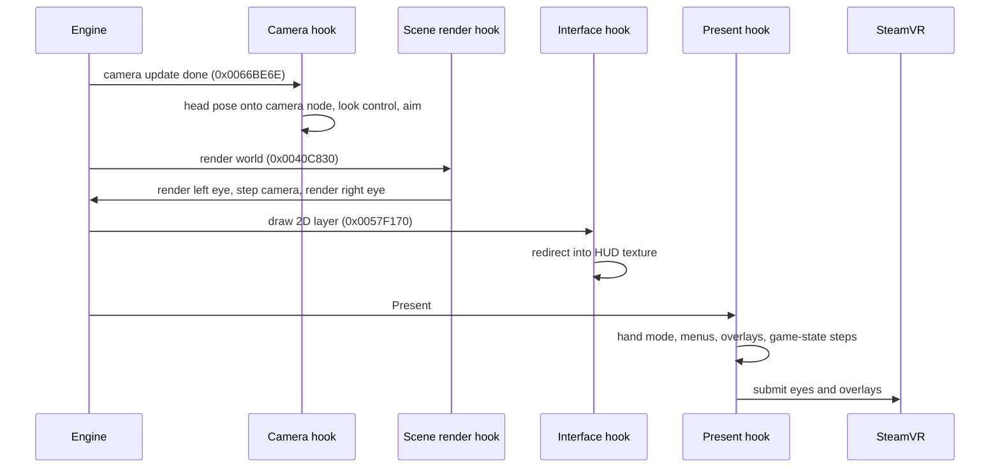

# Architecture overview

OBVR is a 32-bit DLL (`OBVR.dll`) that xOBSE loads into `Oblivion.exe` 1.2.0.416. It keeps the game's own camera and render pipeline and augments them: the head pose is laid onto the engine's camera, the world is rendered once per eye, the 2D layer is captured into a texture, and the results go to SteamVR through OpenVR. The longer, dated architecture write-up is `docs/vr-modding/architecture.md`; it describes commit `43f619c` (0.1.1) and is older than the current code.

## Loading

`src/Plugin.cpp` exports the two xOBSE entry points:

- **`OBSEPlugin_Query`** opens `OBVR.log`, stays inactive in the editor, and refuses to load when xOBSE is older than version 20 or the game is not 1.2.0.416 (`addr::kOblivionVersion_1_2_416`). Refusing leaves the vanilla game.
- **`OBSEPlugin_Load`** claims an OBSE opcode base (the key of OBVR's co-save chunk; without it the quick-key pages are not saved), loads `OBVR.ini`, configures the profiler, starts the update check unless `[Updates] CheckForUpdates=0`, and installs the camera hook (`camera::Install`). If the camera hook is disabled by configuration or cannot be installed, OBVR stays inactive and the game runs unchanged. After it, player-body patches, native menu prototypes, quick-key pages and the console line are installed.
- **`DllMain`** stores the module handle on attach (used to find files next to the DLL) and, on detach, releases any held hand controls, shuts the profiler down and closes the log.

## How code sites are patched

Every engine address lives in `src/game/GameAddresses.h` (about 250 named constants), each valid for 1.2.0.416 only. Patching follows one rule: **check first, patch second**. `mem::Verify` compares the expected original bytes; on a mismatch the subsystem is not installed and `mem::ReportForeignCode` names the DLL whose code sits there, which is how conflicts with other engine mods show up in the log. Three mechanisms are used, each with byte generation kept free of process state so it can be unit-tested:

| Mechanism | Source | Used for |
| --- | --- | --- |
| Mid-function patch + runtime trampoline that rebuilds the displaced branch | `src/camera/CameraTrampoline.cpp` | the camera update at `addr::kHookCameraUpdate` (`0x0066BE6E`) |
| Entry detour: jump to a same-convention replacement, trampoline of the displaced entry instructions | `src/core/EntryDetour.cpp` | whole functions such as the world render `addr::kRenderScene` (`0x0040C830`) and the 2D pass `addr::kRenderInterface` (`0x0057F170`) |
| Around-call stub: OBVR code before and after one engine call, the caller's return address parked so arguments stay in place | `src/core/AroundCall.cpp` | setting the player's heading to the aim only while the engine reads it (`game::InstallAimAtSource`) |

Direct3D 9 methods (Present, SetRenderTarget and others) are hooked by replacing device vtable entries once the device exists.

## One frame

- **Camera hook** — `OBVR_OnCameraUpdated` in `src/camera/CameraHook.cpp` runs after the engine settled the camera. It reads third/first person, composes the tracked head pose onto the camera node (`vr::HeadTracker`, `camera::LookControl`), and handles special views (character creation, dialogue, riding).
- **World render** — `render::InstallSceneRenderHook` detours the world render so it can be called once per eye. See [Rendering and stereo](rendering-and-stereo.md).
- **2D pass** — redirected into OBVR's texture. See [Menus, HUD and settings UI](menus-and-ui.md).
- **Present** — `OnPresent` steps per-frame game logic (world step, stagger and knockback settings, exhaustion), runs the hand mode (`UpdateHandMode`, see [Full VR hands](full-vr-hands.md)), the VR keyboard and overlays, and submits to the compositor.

`src/camera/CameraHook.cpp` is the glue file (over 16,000 lines): it owns the global per-frame state and wires the pure units together. Decisions themselves live in small pure headers (`*Logic.h` and most of `src/vr/`) tested without the game; see [Unit tests](../testing/unit-tests.md).

## Source areas

| Area | Owns |
| --- | --- |
| `src/camera` | camera hook, trampolines, look control, frame logic |
| `src/render` | D3D9 hooks, stereo passes, eye textures, overlays, submit pacing |
| `src/vr` | OpenVR backend, head tracker, the hand mode and its gesture units |
| `src/game` | engine addresses, game-state reads and writes, combat, contact, menus bridge |
| `src/ui` | OBVR's own menus and painters |
| `src/core` | config, log, memory patching helpers, math, watchdog |
| `src/platform` | Windows plumbing: plugin path, game window, import hook, update fetch, freestanding runtime |
| `src/perf` | profiler and GPU queries |
| `src/obse` | the minimal xOBSE interface structs |
| `src/test` | in-game runtimes for the harness |

Configuration is covered in [Configuration](../operations/configuration.md).
